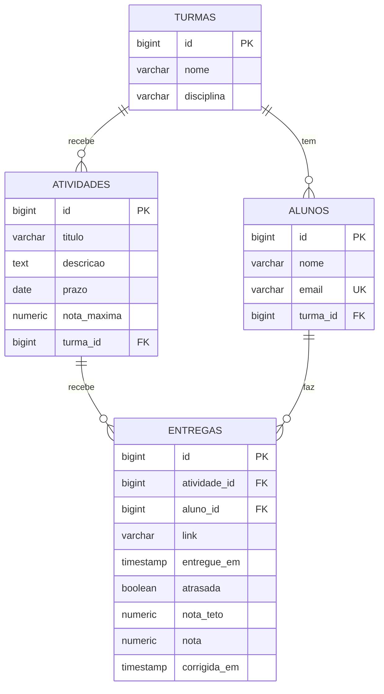

# Modelo de domínio

Quatro entidades e quatro relacionamentos. A coluna **Regra** é o que vira `NOT NULL`, `UNIQUE` ou validação no DTO.

## Entidades

### Turma

Um grupo de alunos de uma disciplina.

| Atributo | Tipo Python | Coluna | Obrigatório | Regra |
|---|---|---|---|---|
| `id` | `int` | `id` | sim | Gerado pelo banco |
| `nome` | `str` | `nome` | sim | Até 100 caracteres. Ex.: "3ª fase noturno" |
| `disciplina` | `str` | `disciplina` | sim | Até 100 caracteres. Ex.: "Backend" |

### Aluno

Quem entrega os trabalhos.

| Atributo | Tipo Python | Coluna | Obrigatório | Regra |
|---|---|---|---|---|
| `id` | `int` | `id` | sim | Gerado pelo banco |
| `nome` | `str` | `nome` | sim | Até 255 caracteres |
| `email` | `str` | `email` | sim | Até 255 caracteres, único |
| `turma` | `Turma` | `turma_id` | sim | Chave estrangeira para `turmas(id)` |

### Atividade

Um trabalho com prazo e nota máxima, passado para uma turma.

| Atributo | Tipo Python | Coluna | Obrigatório | Regra |
|---|---|---|---|---|
| `id` | `int` | `id` | sim | Gerado pelo banco |
| `titulo` | `str` | `titulo` | sim | Até 255 caracteres |
| `descricao` | `str` | `descricao` | não | Texto livre |
| `prazo` | `date` | `prazo` | sim | Último dia para entregar sem atraso |
| `nota_maxima` | `Decimal` | `nota_maxima` | sim | `NUMERIC(4,2)`, maior que zero |
| `turma` | `Turma` | `turma_id` | sim | Chave estrangeira para `turmas(id)` |

### Entrega

O envio de um aluno para uma atividade.

| Atributo | Tipo Python | Coluna | Obrigatório | Regra |
|---|---|---|---|---|
| `id` | `int` | `id` | sim | Gerado pelo banco |
| `atividade` | `Atividade` | `atividade_id` | sim | Chave estrangeira para `atividades(id)` |
| `aluno` | `Aluno` | `aluno_id` | sim | Chave estrangeira para `alunos(id)` |
| `link` | `str` | `link` | sim | Até 500 caracteres. Onde o trabalho está (repositório, pasta, documento) |
| `entregue_em` | `datetime` | `entregue_em` | sim | A API preenche com o momento do envio; o cliente não controla |
| `atrasada` | `bool` | `atrasada` | sim | A API calcula comparando `entregue_em` com o prazo (R2) |
| `nota_teto` | `Decimal` | `nota_teto` | sim | `NUMERIC(4,2)`. A API calcula: a nota máxima, ou 70% dela se atrasada (R2) |
| `nota` | `Decimal` | `nota` | não | `NUMERIC(4,2)`. Vazia até a correção, nunca acima de `nota_teto` (R4) |
| `corrigida_em` | `datetime` | `corrigida_em` | não | Vazia até a correção. Preenchida, bloqueia o reenvio (R3) |

A dupla `(atividade_id, aluno_id)` é única: cada aluno tem uma entrega por atividade (R3).

## Relacionamentos

| De | Para | Tipo | No banco | No código |
|---|---|---|---|---|
| Aluno | Turma | muitos para um | `alunos.turma_id` referencia `turmas(id)` | `relationship` em `Aluno` |
| Atividade | Turma | muitos para um | `atividades.turma_id` referencia `turmas(id)` | `relationship` em `Atividade` |
| Entrega | Atividade | muitos para um | `entregas.atividade_id` referencia `atividades(id)` | `relationship` em `Entrega` |
| Entrega | Aluno | muitos para um | `entregas.aluno_id` referencia `alunos(id)` | `relationship` em `Entrega` |

A regra R1 nasce do cruzamento de dois caminhos: a turma do aluno (`alunos.turma_id`) precisa ser a mesma da atividade (`atividades.turma_id`).

## Diagrama ER

Como ler: `||--o{` é "um para muitos". Uma turma tem zero ou vários alunos, e cada aluno é de exatamente uma turma.

## Migrations

Ficam em `db/migration`, uma tabela por arquivo. A ordem importa: a tabela referenciada nasce antes da que referencia.

| Versão | Arquivo | O que cria | Situação |
|---|---|---|---|
| V1 | `V1__criar_turmas.py` | Tabela `turmas` | Pronta |
| V2 | `V2__criar_alunos.py` | Tabela `alunos`, com a chave estrangeira para `turmas` e o e-mail único | Pronta |
| V3 | `V3__criar_atividades.py` | Tabela `atividades`, com a chave estrangeira para `turmas` | A criar |
| V4 | `V4__criar_entregas.py` | Tabela `entregas`, com as duas chaves estrangeiras e a unicidade de `(atividade_id, aluno_id)` | A criar |
